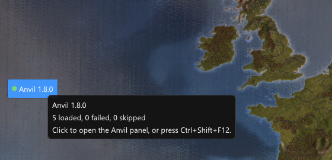

Anvil loads plugins into Europa Universalis IV. It does not change `eu4.exe`, and
[uninstalling](#uninstall) puts the game back at once.

You need **EU4 1.37.5 for Windows (64-bit) from Steam**, or the **GOG build 1.37.5.2**
([On GOG](#on-gog)).

## Install with Anvil Manager

`AnvilManager.exe` installs Anvil and manages its plugins.

1. Download `AnvilManager.exe` with the button on the [home page](../../), or from the
   [latest release](https://github.com/happy-dwarf-team/anvil/releases/latest).
2. Run it. If your browser or Windows warns about the file, see
   [below](#if-windows-warns-about-the-file).
3. The Manager finds the game through Steam or GOG. If it asks, click **Use** next to the
   game, or **Choose the folder...** and pick the folder that contains `eu4.exe`.
4. Click **Install Anvil**. It puts `version.dll`, an `anvil` folder and a copy of the Manager
   next to `eu4.exe`. From now on, start the Manager from the game folder: in Steam, right-click
   Europa Universalis IV → **Manage** → **Browse local files**; in GOG Galaxy, **Manage installation**
   → **Show folder**. **Add to the Start menu** on the **Anvil** tab saves you that walk. You can
   delete the file you downloaded.
5. [Add plugins](../install-plugins/). The **Catalog** tab installs them with a click.
6. Start the game with **Play EU4**, or from Steam, GOG Galaxy or the Paradox launcher as usual.
7. [Check that Anvil runs](#check-that-anvil-runs).

You do not need administrator rights. If Windows refuses access to the game folder, the
Manager offers to start again as administrator.

### If Windows warns about the file

Anvil's files are not code-signed, so Windows does not know them yet:

- **Your browser** may say that the file is not commonly downloaded. Choose to keep it.
- **Windows SmartScreen** may say "Windows protected your PC" on the first start. Choose
  **More info**, then **Run anyway**.

To check the file first, see [Check a download yourself](../safety/#check-a-download-yourself).
If your antivirus removes a file, see
[If your antivirus objects](../safety/#if-your-antivirus-objects).

## On GOG

Anvil and the plugins on the **Catalog** tab run on the GOG build 1.37.5.2.

1. Update the game to 1.37.5.2 in GOG Galaxy. The other GOG build of 1.37.5 (1.37.5.0) is not
   known yet ([#187](https://github.com/happy-dwarf-team/anvil/issues/187)): the game starts,
   but plugins that use game addresses are skipped, and Anvil tells you to update.
2. Follow [Install with Anvil Manager](#install-with-anvil-manager). If the Manager asks for
   the folder, GOG Galaxy shows it under **Manage installation** → **Show folder**.
3. Get plugins from the **Catalog** tab. The Steam Workshop does not reach a GOG game. For
   Mei's fonts see [its page](../../plugins/mei/).
4. Start the game from GOG Galaxy or the Paradox launcher. **Play EU4** opens the Paradox
   launcher, as GOG does: press **Play** there. On its first start the launcher shows Paradox's
   EULA before **Play**. That is the same without Anvil, and only you can accept it.

## Check that Anvil runs

The game's main menu shows a small **Anvil** badge with its version on the left edge. Point at
it to see how many plugins loaded. Click it to open the
[Anvil panel](../using-anvil/#the-anvil-panel).

No badge? See [Troubleshooting](../troubleshooting/).

## Update Anvil

Download the newer `AnvilManager.exe`, run it and click **Install this Anvil**. It replaces
Anvil's own files and the Manager in the game folder. Your plugins, their settings and
`anvil/anvil.toml` stay.

**Repair** on the Manager's **Anvil** tab puts back Anvil's own files if one is missing or
changed.

## Uninstall

With the Manager: on the **Anvil** tab, click **Uninstall Anvil**. It removes `version.dll`,
the standard plugins, `AnvilManager.exe` and its Start menu entry, and the game is vanilla at once. Your plugins,
their settings, crash reports and logs stay, so installing again brings everything back. Tick
**Also remove my plugins…** to remove the whole `anvil` folder too.

By hand: delete `version.dll`, `AnvilManager.exe` and the `anvil` folder, and the Start menu
entry if you added one. Nothing else was changed.

A plugin from the Steam Workshop does nothing without Anvil. To remove it too, unsubscribe
from it.

## Install by hand

If you prefer not to use the Manager:

1. Download `anvil-windows-x64.zip` from the
   [latest release](https://github.com/happy-dwarf-team/anvil/releases/latest).
2. Find the game folder, the one that contains `eu4.exe`. In Steam, right-click Europa
   Universalis IV → **Manage** → **Browse local files**.
3. Extract the archive into that folder. You should now see `version.dll`, `AnvilManager.exe`
   and an `anvil` folder next to `eu4.exe`.
4. Start the game as usual. To update, extract the newer archive over the old one.
